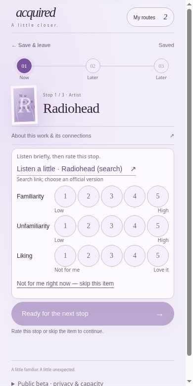

<div align="center">

# Acquired

**A taste-guided cultural discovery agent that builds a gradual route from what you already love to something you want to understand.**

<p>
  <a href="https://acquired.nini-lab.chatgpt.site/"></a>
  
  <a href="./LICENSE"></a>
</p>

</div>

<p align="center">
  
</p>

<p align="center"><sub>Walk a measured route, rate each stop, and reroute when the path does not fit.</sub></p>

---

## Why Acquired

Recommendations are good at giving you *more of what you already like*. They are less helpful when you want to cross a cultural gap: getting into a band, book, film, game, or other creative territory that feels interesting but still unfamiliar.

**Acquired is destination-first, barrier-aware, and adaptive.** You name where you want to go. The agent starts from familiar favorites, asks what blocked you before (**barrier**) and why you want to try now (**motivation**), then builds a measured route toward that specific destination.

Gradual cultural routing has an early precedent in Paul Lamere's 2012 [Boil the Frog](https://musicmachinery.com/2012/02/26/boil-the-frog/), which connected artists through incremental musical similarity. Acquired takes the idea across media and adds personal anchors, explicit barriers and motivations, route constraints, and feedback-driven rerouting.

## How it works

1. **Choose a destination** — the artist, work, or cultural territory you want to enter.
2. **Anchor the route** — add familiar favorites so the agent has a real taste starting point.
3. **Describe the gap** — tell Acquired what has stopped you before, what draws you there now, and any constraints that should shape the journey.
4. **Build a measured route** — Acquired resolves the exact entities and uses Qloo search and taste-graph measurements to construct and validate 3–10 stops.
5. **Walk it** — sample each stop, rate familiarity / unfamiliarity / liking, swap a stop, or rebuild the remaining path when needed.
6. **Keep the journey** — progress, ratings, replacements, and a final reflection can be saved and reopened.

## What Qloo does

Qloo is part of the core routing loop rather than a decorative lookup layer.

Acquired uses Qloo to:

- resolve catalog identities across media;
- measure associations from familiar favorites;
- backtrack from the destination to candidate bridge works;
- validate replacement and reroute candidates;
- surface measured connection evidence when it is available.

When supporting evidence is incomplete, the interface says so instead of inventing an explanation.

## Agent behavior

The route builder includes safeguards for cases that commonly make cultural “entry routes” feel wrong:

- destination works are not recommended early as bridge stops;
- explicit series / sequel ordering is respected when catalog evidence supports it;
- user-selected constraints stay active during reroutes;
- a reroute keeps the already-visited prefix and original destination;
- replacing a stop re-measures the relevant connection;
- partial provider data never gets converted into fabricated certainty.

## Architecture

Browser interactions go through ChatGPT Sites server routes, which handle visitor identity and ownership, request and storage budgets, CAS session persistence, and the Acquired action layer before calling Qloo. Cloudflare D1 stores routes, sessions, usage counters, and build locks.

The Qloo API key and guest-signing secret are server-side runtime secrets and are not included in this repository.

## Stack

`TypeScript` · `React 19` · `Next.js 16` · `Vinext` · `ChatGPT Sites` · `Cloudflare D1` · `Drizzle` · `Qloo API` · `pnpm`

## Repository guide

```text
app/acquired/          Product UI and journey flow
app/api/               Server HTTP boundaries
lib/acquired/          Routing, evidence, persistence and safety logic
db/ + drizzle/         D1 schema and migrations
scripts/               Build support and regression tests
worker/                Sites / Cloudflare runtime entry
```

## Local development

> **Quickest evaluation:** use the [live demo](https://acquired.nini-lab.chatgpt.site/) above. A full local run needs the Sites runtime bindings and secrets used by the hosted app.

```bash
pnpm install
pnpm dev
```

The hosted application expects runtime bindings and secrets such as `DB`, `QLOO_API_KEY`, and `ACQUIRED_GUEST_SECRET`.

## Selected checks

Regression coverage includes route boundaries, destination / series rules, Qloo transport behavior, provider failures, session CAS, offline visitor-isolation tests, route-library counting, English intent parsing, and responsive UI behavior.

```bash
node --experimental-strip-types scripts/test-public-release.mjs
node --experimental-strip-types scripts/test-acquired-transport.mjs
node node_modules/typescript/bin/tsc --noEmit
```

The checks above run locally with fixtures or mocked provider responses and do not require live Qloo requests.

## License

Except where otherwise noted, Acquired is licensed under the **GNU Affero General Public License v3.0 only (AGPL-3.0-only)**. See [LICENSE](./LICENSE) for the full terms. Third-party components retain their respective licenses.

If you modify Acquired and make the modified version available to users over a network, the AGPL requires you to offer those users the corresponding source code under the same license.

---

<div align="center">

**Don't recommend what I already like. Take me somewhere new, slowly enough that I follow.**

</div>
